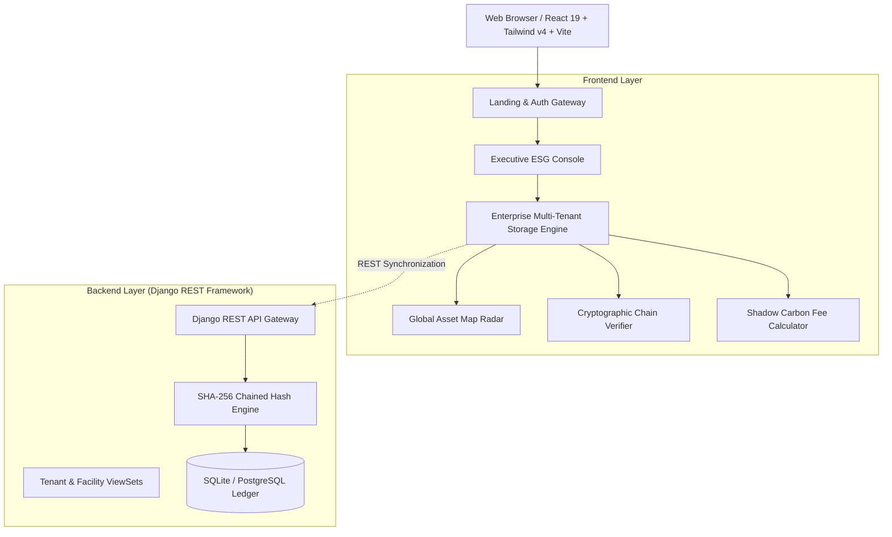

# 🌐 OmniESG Global · Enterprise Operating System
### *Global Multi-Tenant Sustainability Intelligence & Cryptographic Assurance Cloud*

[](https://vercel.com/new)


---

## 📌 Executive Overview

**OmniESG Global** is an enterprise-grade multi-tenant ESG intelligence platform and operating system designed for multinational conglomerates, real estate investment trusts (REITs), and corporate holdings. 

It unifies cross-border greenhouse gas (GHG) accounting, real-time facility telemetry, internal shadow carbon liability modeling, and automated regulatory reporting into a zero-trust, cryptographically verified architecture.

Every single data mutation—from utility invoices and automated smart-meter readings to baseline emission factor adjustments—is sealed in an immutable **SHA-256 cryptographic audit block ledger**, providing verifiable assurance for independent auditors (ISAE 3000 / SOC 2 Type II).

---

## ✨ Core Platform Features

### 1. 🔐 Interactive Landing & Enterprise Access Gateway
* **Seamless Entry Experience:** Instant one-click persona switching and enterprise SSO simulation (Okta / Microsoft Entra ID).
* **Pre-Configured Enterprise Roles:**
  * **Priya Sharma** (`SUSTAINABILITY_MANAGER`) — Full read/write GHG targets, facility emissions, and calibration factors.
  * **Marcus Vance** (`ESG_AUDITOR`) — Independent assurance, cryptographic chain verification, and auditor sign-off.
  * **Elena Rostova** (`TENANT_ADMIN`) — Corporate governance, tenant onboarding, API keys, and policy administration.
  * **David Chen** (`FACILITY_CONTRIBUTOR`) — Scope-restricted data ingestion and facility sub-meter operations.

### 2. 🛡️ Tamper-Proof Cryptographic Audit Ledger
* **Merkle-Linked Block Chain:** Every entry contains `blockIndex`, `timestamp`, `userId`, `action`, `previousHash`, and `currentHash`.
* **Zero-Trust Chain Integrity Verifier:** Real-time modal inspecting cryptographic consensus across the entire block sequence.
* **Tamper Simulation Engine:** Built-in auditor demonstration showing immediate hash invalidation upon unauthorized direct database tampering.

### 3. 📉 TCFD Shadow Carbon Pricing & Financial Liability Engine
* **Dynamic Fee Calibration:** Interactive slider modeling internal carbon fees from **$20/tCO₂e** to **$250/tCO₂e** (supporting `$`, `€`, `£`, `₹`, `¥`, `S$`, `A$`).
* **Financial Exposure Breakdown:**
  * Scope 1 direct fuel exposure
  * Scope 2 electricity grid liability
  * 2030 Net-Zero capital allocation and risk mitigation savings.

### 4. 🗺️ Global Asset Radar & Sub-Meter Telemetry
* **Equirectangular Radar Projection:** Live worldwide radar view across AMER, EMEA, and APAC.
* **Pulsating Facility Status Pins:** Color-coded operational status, gross floor area, energy circularity, and connected IoT sub-meters (Grid Electricity, Rooftop Solar, Diesel Genset, Chiller HVAC).

### 5. 🏢 Dynamic Global Enterprise Onboarding
* **Multi-Tenant Isolation:** Register any multinational corporation with localized jurisdictions, currency symbols, and baseline years.
* **Supported Frameworks:**
  * **EU CSRD / ESRS E1** (European Union)
  * **US SEC Climate Disclosure Rules** (United States)
  * **SEBI BRSR Core** (India)
  * **ISSB IFRS S1 & S2** (Global baseline)
  * **GHG Protocol & ISO 14064-1**
* **Genesis Block Minting:** Automatically seeds isolated operational data and mints cryptographic Genesis Block #0.

### 6. 📄 Automated Compliance Dossiers
* **One-Click Dossier Generation:** Pre-formatted regulatory filings with full methodology notes, facility distribution, and SHA-256 cryptographic verification seals.
* **Export Formats:** High-fidelity PDF dossier and RFC 4180-compliant CSV exports.

---

## 🏛️ System Architecture



---

## 🚀 Quick Start Guide

### Prerequisites
* **Node.js** (v18.x or v20.x recommended)
* **npm** (v9.x or v10.x)
* **Python 3.10+** (optional, for backend Django API)

### 1. Frontend Development Server (Vite)
```bash
# Install dependencies
npm install

# Start local dev server
npm run dev
```
The application will be accessible at: **`http://localhost:3000`**

### 2. Type Checking & Production Build
```bash
# Validate TypeScript strict types
npm run lint

# Build optimized production bundle
npm run build

# Preview production build locally
npm run preview
```

### 3. Optional: Backend Django REST API
```bash
# Activate Python virtual environment
# Windows:
.\venv\Scripts\activate
# macOS/Linux:
source venv/bin/activate

# Run database migrations
python backend/manage.py migrate

# Start Django API server on port 8000
python backend/manage.py runserver 8000
```
The API root will be accessible at: **`http://127.0.0.1:8000/api/`**

---

## ☁️ Deploying to Vercel

The frontend is fully configured for zero-configuration, continuous deployment on **Vercel**.

### Option A: Deploy via GitHub (Recommended)
1. Push this repository to your GitHub account:
   ```bash
   git init
   git add .
   git commit -m "feat: initial commit of OmniESG Global Enterprise OS"
   git branch -M main
   git remote add origin https://github.com/<your-username>/<your-repo-name>.git
   git push -u origin main
   ```
2. Go to [Vercel Dashboard](https://vercel.com/new).
3. Click **"Add New Project"** and import your GitHub repository.
4. Vercel automatically detects the project settings from `vercel.json`:
   * **Framework Preset:** `Vite`
   * **Build Command:** `npm run build`
   * **Output Directory:** `dist`
   * **Install Command:** `npm install`
5. Click **"Deploy"**. Your live production URL will be ready in under 60 seconds!

### Option B: Deploy via Vercel CLI
```bash
# Install Vercel CLI globally
npm install -g vercel

# Deploy directly from terminal
vercel
```

---

## 📁 Project Structure

```
├── src/
│   ├── components/
│   │   ├── Admin/             # Onboarding modal, RBAC matrix, settings
│   │   ├── AuditLogs/         # Tamper-proof table, diff viewer, chain verifier
│   │   ├── Auth/              # Landing page & Enterprise Access Gateway
│   │   ├── Dashboard/         # Scope cards, anomaly alerts, shadow carbon fee
│   │   ├── DataEntry/         # Log emission modal & factor calibration
│   │   ├── EntityMapping/     # Global Asset Map Radar & facility tree
│   │   ├── Reports/           # Compliance reports & dossier modal
│   │   └── Header.tsx         # Multi-tenant header & role selector
│   ├── data/                  # Pre-seeded global enterprise records
│   ├── types/                 # TypeScript interfaces (ESG, RBAC, Tenant, Audit)
│   ├── utils/                 # Cryptographic hasher, CSV/PDF exporters, storage
│   ├── App.tsx                # Main container & state coordination
│   ├── main.tsx               # DOM bootstrap
│   └── index.css              # Tailwind CSS styles & animations
├── backend/                   # Optional Django REST API
│   ├── core/                  # Models (Tenant, Facility, AuditLog, Emission)
│   └── esg_enterprise/        # Django settings, URLs, WSGI
├── vercel.json                # Vercel deployment configuration & SPA rewrites
├── vite.config.ts             # Vite bundler configuration
├── tsconfig.json              # TypeScript compiler options
└── package.json               # Dependencies and scripts
```

---

## 📜 Compliance & Security Notes
* **ISAE 3000 & SOC 2 Type II:** Cryptographic hashing guarantees non-repudiation.
* **Client-Side Consensus:** Offline fallback ensures full audit trail preservation even if network connectivity is interrupted.
* **Deterministic Calculations:** Scope 1, 2 (market & location-based), and 3 formulas strictly adhere to the **GHG Protocol Corporate Standard**.

---

## 📄 License
This project is licensed under the Apache-2.0 License.
